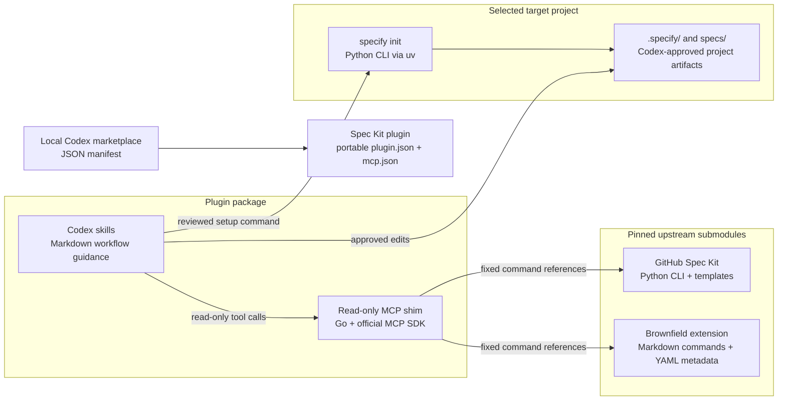
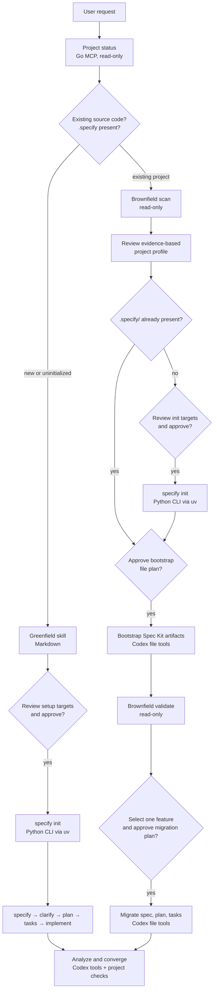

# Spec Kit for Codex: architecture and workflow routing

Shows the local Codex plugin's language boundaries and its greenfield and brownfield paths.

## Plugin architecture and language boundaries

<!-- mermaid:id=plugin-architecture -->

## Greenfield and brownfield workflow gates

<!-- mermaid:id=greenfield-brownfield-routing -->

